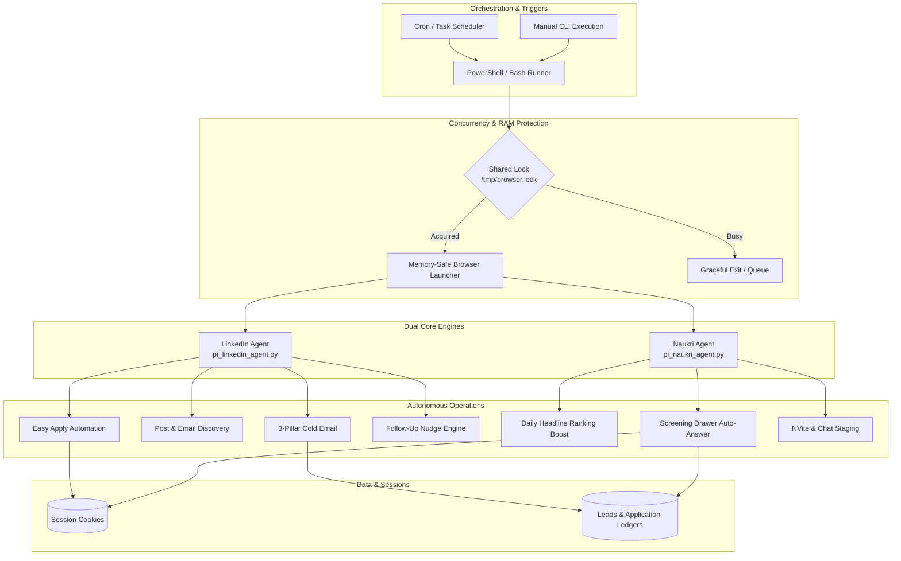

# 🚀 Autonomous Job Application Agents (LinkedIn & Naukri)

<p align="center">
  
  
  
  
  
</p>

An intelligent, memory-conscious dual-agent automation suite engineered to manage end-to-end job discovery, 1-click Easy Apply submissions, profile algorithm ranking boosts, and recruiter outreach across **LinkedIn** and **Naukri.com**.

Optimized specifically for resource-constrained edge hardware (such as a **Raspberry Pi 3B+ with 1 GB RAM**) as well as standard **Windows / macOS / Linux** developer environments.

---

## 🌟 Key Highlights & Capabilities

### 💼 LinkedIn Agent (`vedant-job-agent`)
- **Auto 1-Click Easy Apply:** Traverses search results, answers multi-step modal questions (experience, CTC, notice period), attaches your resume PDF, and stages or auto-submits applications.
- **Hiring Post Scanner:** Scrapes organic recruiter posts, extracts verified corporate/founder email addresses, and scores relevance against your target keywords.
- **3-Pillar Cold Email Engine:** Crafts tailored value-proposition emails to hiring managers with dynamic subject lines and attachments via Gmail SMTP.
- **Referral DM Drafter:** Composes high-converting referral requests for internal employees with human-like typing cadence.
- **Smart Inbox Follow-Ups:** Scans message threads and automates gentle follow-up nudges for unreplied conversations after a configurable interval (e.g. 3 days).

### 🎯 Naukri.com Agent (`vedant-naukri-agent`)
- **Daily Ranking Algorithm Booster:** Automates micro-updates to your resume headline at 8:55 AM IST (e.g., toggling trailing dot), securing the top **"Profile Updated Today"** badge in recruiter candidate searches.
- **1-Click Search & Apply:** Searches targeted keywords and locations, opens application drawers, and accurately fills screening forms using regex-matched ground truth answers.
- **Recruiter NVite / Chat Drafter:** Scans recruiter NVites and chats, extracts contact information, and generates tailored instant replies.
- **External Redirect Tracker:** Identifies external careers portal redirects and saves them to a clean JSON ledger for manual review.

### 🛡️ Hardware & Anti-Ban Architecture
- **Shared Memory Lock (`flock`):** Guarantees that LinkedIn and Naukri browser instances never run concurrently in RAM, eliminating OOM crashes.
- **Headless Bloat Stripper:** Aborts images, fonts, stylesheets, and tracking scripts to reduce page payload by up to ~75%.
- **V8 Heap Caps:** Constrains the JavaScript engine (`--max-old-space-size=256`, `--disable-dev-shm-usage`, `--single-process`).
- **Human Mimicry:** Randomized delays (2–5s) and human-cadence keystroke delays prevent bot triggers.
- **ecoMode Integration:** Token-saving semantic compression for templates and LLM prompt budgeting.

---

## 📐 System Architecture



---

## 📁 Repository Structure

```text
job-apply-skill/
├── run_linkedin.ps1             # Windows 1-click runner for LinkedIn
├── run_naukri.ps1               # Windows 1-click runner for Naukri
├── .gitignore                   # Complete security & privacy rules
├── README.md                    # Documentation & setup guide
│
├── vedant-job-agent/            # 🤖 LinkedIn Automation Skill
│   ├── run_agent.sh             # Linux/Pi memory-safe runner (flock)
│   ├── setup_pi.sh              # One-command Raspberry Pi installation
│   ├── SKILL.md                 # Antigravity skill specification
│   ├── .env.example             # Configuration template
│   ├── scripts/
│   │   ├── pi_linkedin_agent.py # Main LinkedIn execution engine
│   │   ├── post_outreach_agent.py # Scraped post & email processor
│   │   └── ecomode.py           # Semantic token compression
│   └── references/
│       └── outreach_templates.md# 3-pillar outreach & DM templates
│
└── vedant-naukri-agent/         # ⚡ Naukri.com Automation Skill
    ├── run_naukri_agent.sh      # Linux/Pi memory-safe runner (flock)
    ├── setup_naukri_pi.sh       # One-command Raspberry Pi installation
    ├── SKILL.md                 # Antigravity skill specification
    ├── .env.example             # Configuration template
    ├── data/
    │   ├── screening_answers.json         # Candidate ground-truth QA
    │   └── screening_answers.example.json # Reference QA template
    ├── scripts/
    │   └── pi_naukri_agent.py   # Main Naukri execution engine
    └── references/
        └── naukri_templates.md  # Headline & recruiter reply templates
```

---

## ⚡ Quick Start

### 1. Prerequisites
- Python 3.10+
- Chromium Browser (or Playwright default browser)
- Git

### 2. Clone Repository & Setup Virtual Environment
```bash
git clone https://github.com/vineetvedant/job-apply-skill-.git
cd job-apply-skill-

python -m venv venv
# On Windows:
.\venv\Scripts\activate
# On Linux / macOS / Raspberry Pi:
source venv/bin/activate

pip install playwright python-dotenv rich scrapling
playwright install chromium
```

### 3. Configure Credentials & Candidate Details
Copy `.env.example` in both agent directories:

```bash
# Configure LinkedIn Agent
cp vedant-job-agent/.env.example vedant-job-agent/.env

# Configure Naukri Agent
cp vedant-naukri-agent/.env.example vedant-naukri-agent/.env
```

Edit each `.env` with your credentials:
```ini
# LinkedIn / Naukri Logins
LINKEDIN_EMAIL=your_email@example.com
LINKEDIN_PASSWORD=your_password
NAUKRI_EMAIL=your_email@example.com
NAUKRI_PASSWORD=your_password

# Gmail SMTP (for automated cold email outreach)
GMAIL_ADDRESS=your_email@gmail.com
GMAIL_APP_PASSWORD=your_16_char_google_app_password

# Candidate Profile
CANDIDATE_NAME=Your Full Name
CANDIDATE_PHONE=+919876543210
CURRENT_ROLE=Software Engineer
CURRENT_COMPANY=Your Company
RESUME_PATH=/path/to/your/resume.pdf
```

---

## 💻 Usage

### Running on Windows (PowerShell)

Run the included interactive helper scripts:

```powershell
# LinkedIn Agent Modes: login, scan-posts, easy-apply, pipeline, referral, email, inbox
.\run_linkedin.ps1 -Mode easy-apply

# Naukri Agent Modes: login, refresh-profile, search-apply, inbox, email
.\run_naukri.ps1 -Mode search-apply
```

### Running on Raspberry Pi / Linux

First-time Pi setup (configures 2GB swap, permissions, and dependencies):
```bash
cd vedant-job-agent && sudo ./setup_pi.sh
cd ../vedant-naukri-agent && sudo ./setup_naukri_pi.sh
```

Execute agents with memory protection (`flock`):
```bash
# Step 1: Initial Login (run once interactively to save session cookies)
./vedant-job-agent/run_agent.sh --mode login
./vedant-naukri-agent/run_naukri_agent.sh --mode login

# Step 2: Autonomous Runs
./vedant-job-agent/run_agent.sh --mode easy-apply
./vedant-naukri-agent/run_naukri_agent.sh --mode search-apply
```

---

## 🕹️ CLI Mode Reference

### LinkedIn Agent (`pi_linkedin_agent.py`)

| Mode | Command | Description |
|---|---|---|
| `login` | `--mode login` | Launches headed browser to solve captcha/2FA and save session cookies. |
| `easy-apply` | `--mode easy-apply` | Submits 1-click Easy Apply applications matching search keywords. |
| `scan-posts` | `--mode scan-posts` | Scans organic recruiter feed posts and extracts verified hiring emails. |
| `email` | `--mode email` | Dispatches 3-pillar cold emails to discovered hiring leads (human confirmation). |
| `referral` | `--mode referral` | Stages referral requests to employees at target companies. |
| `inbox` | `--mode inbox` | Checks messages for replies and drafts follow-up nudges for stale threads. |
| `pipeline` | `--mode pipeline` | Runs sequential full pipeline: scan → apply → stage outreach. |

### Naukri Agent (`pi_naukri_agent.py`)

| Mode | Command | Description |
|---|---|---|
| `login` | `--mode login` | Opens browser for one-time Naukri login and cookie generation. |
| `refresh-profile` | `--mode refresh-profile` | Toggles headline micro-update to trigger **"Updated Today"** recruiter badge. |
| `search-apply` | `--mode search-apply` | Searches jobs, answers screening questions, and submits applications. |
| `inbox` | `--mode inbox` | Inspects recruiter NVites/messages and drafts personalized responses. |
| `email` | `--mode email` | Sends structured 3-pillar follow-ups to recruiters found in job posts. |

---

## ⏰ Automated Cron Schedule (Raspberry Pi)

Add to `crontab -e` for 24/7 autonomous job searching without lifting a finger:

```cron
# 08:55 AM IST - Boost Naukri profile rank right before recruiters begin searches
55 8 * * * /home/pi/vedant-naukri-agent/run_naukri_agent.sh --mode refresh-profile >> /home/pi/agent.log 2>&1

# 09:30 AM IST - LinkedIn Easy Apply run
30 9 * * * /home/pi/vedant-job-agent/run_agent.sh --mode easy-apply >> /home/pi/agent.log 2>&1

# 11:30 AM IST - Naukri 1-Click Apply run
30 11 * * * /home/pi/vedant-naukri-agent/run_naukri_agent.sh --mode search-apply >> /home/pi/agent.log 2>&1

# 02:30 PM IST - Scan LinkedIn posts for new hiring emails
30 14 * * * /home/pi/vedant-job-agent/run_agent.sh --mode scan-posts >> /home/pi/agent.log 2>&1

# 05:00 PM IST - Check inboxes and stage follow-up nudges
00 17 * * * /home/pi/vedant-job-agent/run_agent.sh --mode inbox >> /home/pi/agent.log 2>&1
```

---

## 🔒 Security & Privacy

1. **Zero Secret Leakage:** `.env` and `.session` files are strictly excluded via `.gitignore`.
2. **Local Session Storage:** Session cookies and tokens remain exclusively on your local filesystem under strict permissions (`chmod 600` / `chmod 700`).
3. **Human Approval:** Cold email dispatches require manual console verification `[y/N/s/q]` before any email leaves your account.

---

## 📜 License

Distributed under the [MIT License](LICENSE).
Built with ❤️ for automated, respectful, and high-impact career growth.
